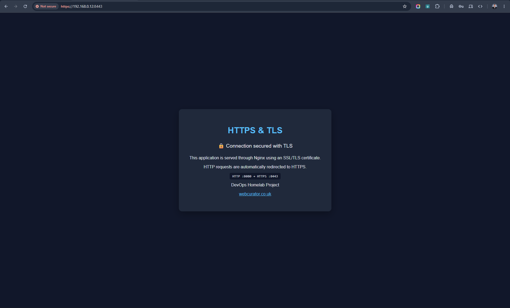
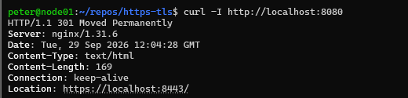
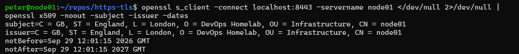

# HTTPS & TLS with Nginx

A DevOps homelab project demonstrating HTTPS, TLS certificates and automatic HTTP-to-HTTPS redirection using Nginx and Docker Compose.

## Architecture

```text
Client
  |
  | HTTP :8080
  v
Nginx
  |
  | 301 Redirect
  v
HTTPS :8443
  |
  | TLS 1.2 / TLS 1.3
  v
Secure Web Application
```

## Technologies

- Linux
- Docker
- Docker Compose
- Nginx
- OpenSSL
- HTTPS
- TLS 1.2 / TLS 1.3

## Features

- HTTPS-enabled Nginx web server
- TLS certificate configuration
- Automatic HTTP-to-HTTPS `301` redirect
- TLS 1.2 and TLS 1.3 support
- Docker Compose deployment
- Read-only configuration and certificate mounts
- TLS private key excluded from version control

## Project Structure

```text
https-tls/
├── certs/
│   └── server.crt
├── nginx/
│   └── default.conf
├── screenshots/
├── site/
│   └── index.html
├── .gitignore
├── compose.yaml
└── README.md
```

The TLS private key (`server.key`) is deliberately excluded from version control.

## Run

```bash
sudo docker compose up -d
```

HTTPS is available on:

```text
https://localhost:8443
```

HTTP requests on port `8080` are automatically redirected to HTTPS on port `8443`.

## Verification

Test HTTPS:

```bash
curl -k -I https://localhost:8443
```

Test the HTTP-to-HTTPS redirect:

```bash
curl -I http://localhost:8080
```

Inspect the TLS certificate:

```bash
openssl s_client -connect localhost:8443 -servername node01 </dev/null 2>/dev/null \
  | openssl x509 -noout -subject -issuer -dates
```

## Certificate

This homelab uses a self-signed TLS certificate generated with OpenSSL for demonstration and learning purposes.

Because the certificate is self-signed, browsers will not trust it automatically. A production deployment would normally use a certificate issued by a trusted Certificate Authority, such as Let's Encrypt.

## Evidence

### HTTPS website



### HTTP to HTTPS redirect



### TLS certificate inspection



## Author

Peter Parker  
[webcurator.co.uk](https://webcurator.co.uk)
